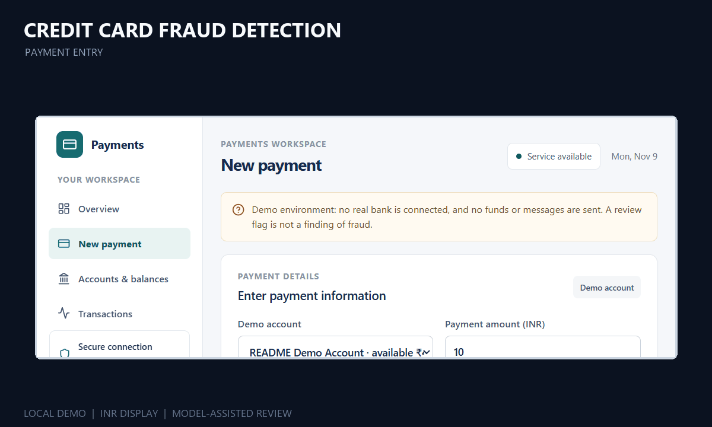
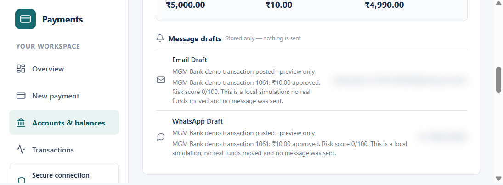
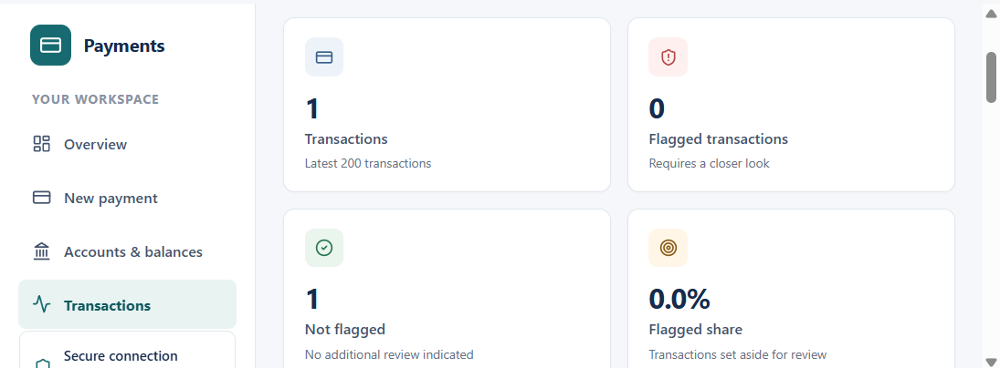
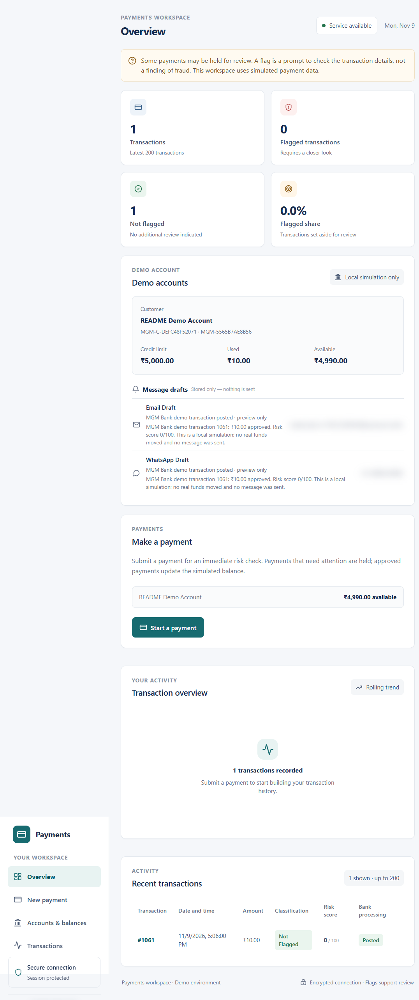
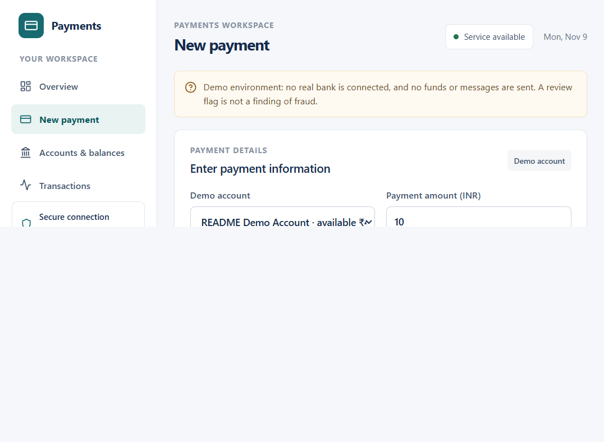
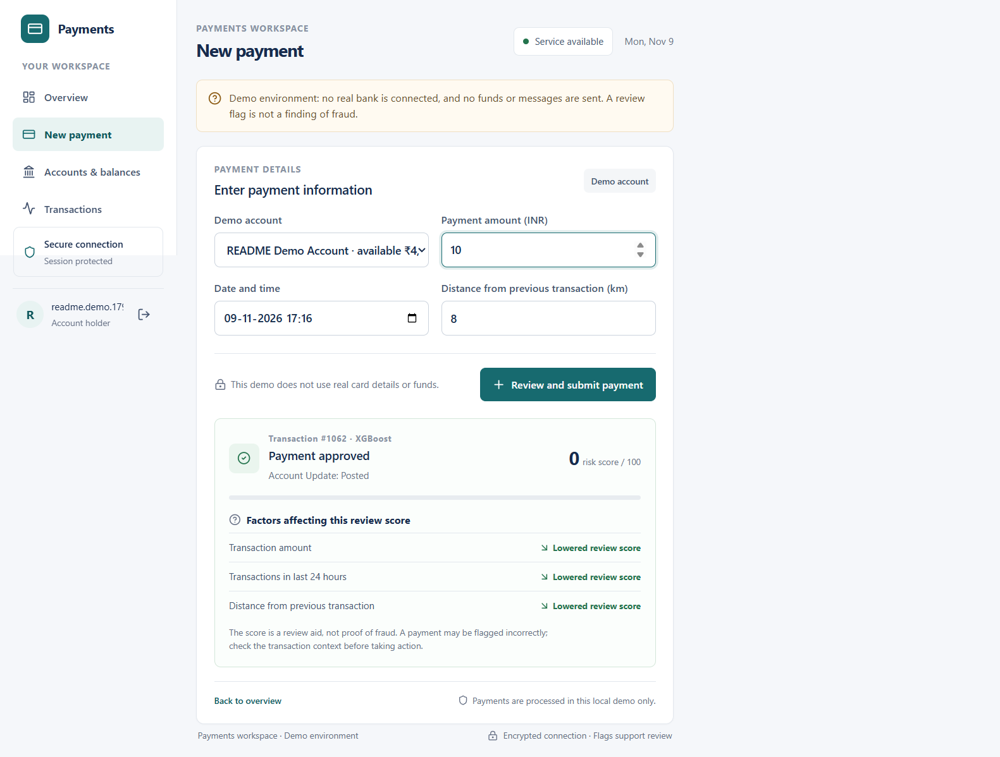
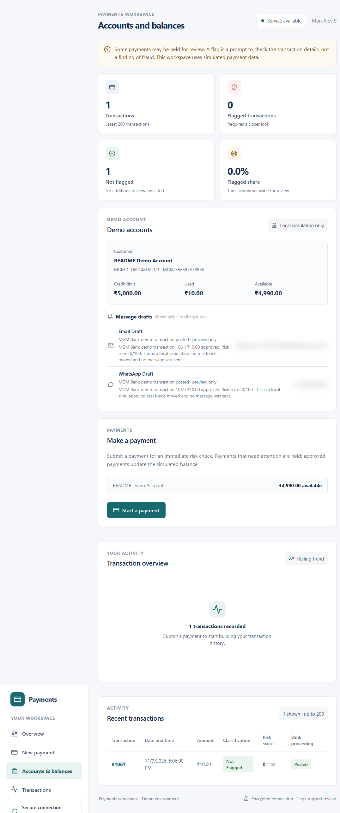
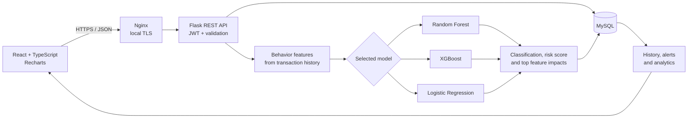

# Credit Card Fraud Detection and Real-Time Review

A full-stack demonstration of synchronous transaction scoring, explainable
model output, and a simulated payment-review workflow. The application brings
together a React and TypeScript client, a Flask REST API, machine-learning
models, and a MySQL-backed transaction ledger.

> **Important:** This is a local demo, not a banking product. It does not
> connect to a real bank, accept card credentials, transfer real funds, or send
> email or WhatsApp messages. Scores support review; they are not proof of
> fraud.

## Product tour

The animated preview plays inline in GitHub and other Markdown viewers. Open or
download the [full 18-second WebM walkthrough](docs/media/project-demo.webm).



<p align="center">
  
  
</p>

<details>
  <summary>View the full screenshot gallery</summary>

  <p><strong>Application overview</strong></p>
  

  <p><strong>Payment entry</strong></p>
  

  <p><strong>Transaction result and feature explanation</strong></p>
  

  <p><strong>Accounts, balances, and notification previews</strong></p>
  
</details>

The screenshots use synthetic demo data. Notification recipients are obscured;
message previews are stored in the application and are not delivered.

## What the project demonstrates

- **Synchronous scoring:** Submitting a transaction returns a model result,
  classification, 0–100 risk score, and feature-level explanation.
- **Model comparison:** Random Forest, XGBoost, and Logistic Regression are
  trained and evaluated with accuracy, precision, recall, F1, PR-AUC, and
  confusion-matrix counts.
- **Behavior-derived features:** The API computes recent transaction count and
  30-day average amount from transaction history, alongside amount, hour, and
  distance from the previous transaction.
- **Review and analytics:** Admin-only dashboards summarize activity, compare
  models, and support alert review.
- **Transactional simulator:** The MGM Bank demo keeps account balances,
  ledger entries, fraud holds, and notification previews in MySQL. An
  idempotency key protects bank-transaction retries.
- **Secure local transport:** Docker Compose places the services on private
  networks and exposes the UI through a local HTTPS reverse proxy.
- **INR presentation:** Account limits, balances, payment amounts, and
  notification previews are displayed in rupees. Demo values are not converted
  from another currency.

## Architecture



### Request and payment flow

1. The authenticated client submits a transaction and model selection to the
   Flask API.
2. The API validates the request and derives behavioral features from the
   user's history; it does not accept raw card numbers or CVV data.
3. The selected model scores the transaction. The response includes the
   classification, review score, threshold, and the leading feature impacts.
4. The prediction and any fraud alert are persisted. For simulated bank
   payments, the prediction, account update, ledger entry, and notification
   previews are handled atomically; retries with the same idempotency key do
   not create duplicate payments.

If a requested model is unavailable, the API reports an error instead of
silently treating the transaction as genuine.

## Technology

| Area | Technologies |
|---|---|
| Frontend | React 18, TypeScript, Vite, Tailwind CSS, Recharts |
| API | Python 3.12, Flask, Flask-JWT-Extended, Flask-SQLAlchemy |
| Machine learning | scikit-learn, XGBoost, SHAP |
| Data processing | Pandas, NumPy |
| Persistence | MySQL 8.4, SQLAlchemy |
| Runtime and transport | Docker Compose, Nginx, local HTTPS |
| Quality checks | Pytest, TypeScript/Vite production build, Compose validation |

## Run locally

### Prerequisites

- Docker Desktop with Docker Compose
- PowerShell

### Start the stack

From the repository root:

1. Create a local environment file:

   ```powershell
   Copy-Item .env.example .env
   ```

2. Edit `.env` before starting. Replace `MYSQL_ROOT_PASSWORD` with a strong,
   unique local password and set `JWT_SECRET_KEY` to a unique secret of at
   least 32 random bytes. Never commit `.env` or use development credentials
   in production.
3. Generate a self-signed development certificate:

   ```powershell
   .\scripts\generate-dev-certs.ps1
   ```

4. Build and start the application:

   ```powershell
   docker compose up --build
   ```

   The first start may take a few minutes while demo models are trained.
5. Open [https://localhost](https://localhost). The browser may show a
   certificate warning because the certificate is self-signed and intended
   only for local development.
6. To create an administrator, open a second terminal and run:

   ```powershell
   docker compose exec backend flask --app app.wsgi:app create-admin
   ```

   Set the administrator email and password when prompted. Other users can
   register through the application.

The Compose configuration binds HTTP and HTTPS to `127.0.0.1`; services and
MySQL are not exposed as public endpoints. Stop the application with
`Ctrl+C`. `docker compose down` stops the services while retaining the
database volume.

## Train with your own labeled data

Training is optional. Use only data you are authorized to process. Place a CSV
at `backend/data/transactions.csv` with the following fields:

| Column | Description |
|---|---|
| `amount` | Transaction amount |
| `transaction_hour` | Hour of transaction, 0–23 |
| `transactions_last_24h` | Recent transaction count |
| `avg_amount_30d` | Average transaction amount over 30 days |
| `distance_from_last_km` | Distance from the previous transaction |
| `is_fraud` | Binary label: `0` genuine, `1` fraud |
| `occurred_at` | Optional timestamp for chronological splitting |

When `occurred_at` is supplied, unique timestamps are kept together in
chronological 60/20/20 train/validation/test partitions. Otherwise, the trainer
uses stratified 64/16/20 partitions. Both classes must be represented in each
partition. Preprocessing and threshold selection use training and validation
data; the held-out test partition is used for reported evaluation.

1. Stop the running stack and set `DEMO_MODE=false` in `.env`.
2. Train the models:

   ```powershell
   docker compose run --rm backend python -m app.train --csv /app/data/transactions.csv
   ```

3. Restart the stack:

   ```powershell
   docker compose up --build
   ```

Generated model artifacts and evaluation metrics are stored in
`backend/models/` and are excluded from Git. The model comparison dashboard
shows accuracy, precision, recall, F1, PR-AUC, thresholds, and confusion
matrices. On imbalanced data, accuracy alone is not a sufficient measure.

The API expects the engineered features above; it does not ingest raw card
numbers, CVVs, merchant feeds, or arbitrary benchmark schemas.

## API overview

All application endpoints use the `/api` prefix. Protected endpoints require
the bearer token returned by login.

| Method | Endpoint | Purpose |
|---|---|---|
| `POST` | `/api/auth/register` | Register a user and create a simulated account |
| `POST` | `/api/auth/login` | Authenticate and return a token |
| `GET` | `/api/auth/me` | Return the authenticated user |
| `POST` | `/api/transactions` | Score and store a transaction |
| `GET` | `/api/transactions` | Return transaction history |
| `GET` | `/api/admin/analytics?period=daily` | Return daily admin analytics |
| `GET` | `/api/admin/analytics?period=monthly` | Return monthly admin analytics |
| `GET` | `/api/admin/model-comparison` | Return trained model metrics |
| `GET` | `/api/admin/alerts` | List alerts |
| `PATCH` | `/api/admin/alerts/{id}` | Update alert review status |
| `GET` | `/api/bank/accounts` | Return the user's simulated accounts |
| `POST` | `/api/bank/transactions` | Score and process a simulated payment |
| `GET` | `/api/bank/transactions` | Return authorized bank transaction history |
| `GET` | `/api/bank/notifications` | Return stored message previews |
| `GET` | `/health` | Check API health |

Bank transaction submissions require a positive amount, timezone-aware ISO-8601
timestamp, non-negative transaction distance, model name, account ID, and a
unique `Idempotency-Key`. Fraud holds and insufficient-limit declines do not
debit the simulated account.

## Tests and CI

Run backend tests using the Compose environment:

```powershell
docker compose run --rm backend python -m pytest -q
```

Build and type-check the frontend:

```powershell
Push-Location .\frontend
npm ci
npm run build
Pop-Location
```

Validate the Compose configuration:

```powershell
docker compose --env-file .env.example config --quiet
```

GitHub Actions runs backend tests on Python 3.12, builds the frontend on
Node.js 22, and validates the Compose configuration on pushes and pull
requests.

## Project structure

```text
.
├── backend/
│   ├── app/                 Flask API, feature engineering, models, training
│   ├── mgm_bank/            Simulated bank accounts, ledger, and previews
│   ├── tests/               Backend API and transaction tests
│   ├── data/                Optional local training CSV (gitignored)
│   └── models/              Generated model artifacts (gitignored)
├── frontend/
│   └── src/                 React application and shared UI utilities
├── docs/media/              README screenshots and demo video
├── nginx/                   Local HTTPS reverse-proxy configuration
├── scripts/                 Local development helpers
├── tls/                     Local development certificates
├── docker-compose.yml
└── README.md
```

## Model and system limitations

- The default demo models are trained on generated, rule-labeled synthetic
  data. Their evaluation metrics measure agreement with those generated
  labels, not real-world fraud-detection performance.
- The displayed 0–100 risk score is a scaled model score, not a calibrated
  probability, proof of fraud, or explanation of intent.
- Feature explanations report model input impacts; they do not establish why
  a transaction occurred. New users also have limited behavioral history.
- Graph machine learning and automatic/adaptive retraining are not
  implemented.
- The bank simulator, payment postings, and notification previews are local
  demo behavior only. No real bank connection, funds transfer, email, or
  WhatsApp delivery exists.
- The repository documents a local demo; it does not include a hosted
  production service.

For production, replace the local self-signed TLS setup, use least-privilege
database credentials and managed secrets, add schema migrations and backups,
and define data retention, consent, monitoring, and incident-response
controls. Do not expose the development Flask server or MySQL directly to the
internet.
